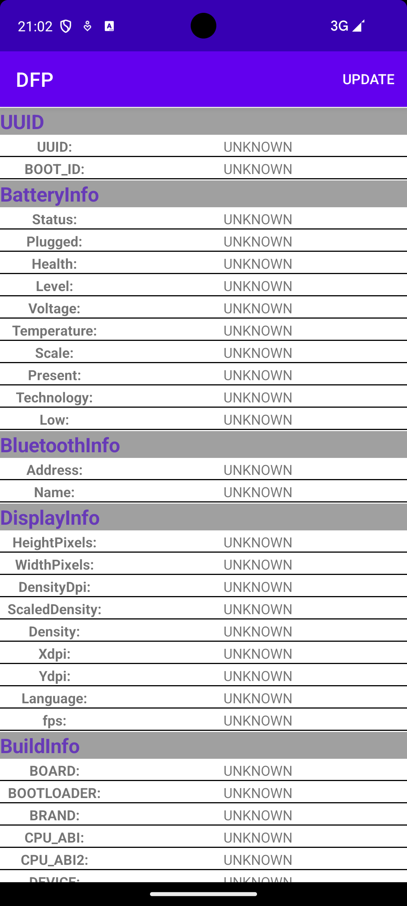
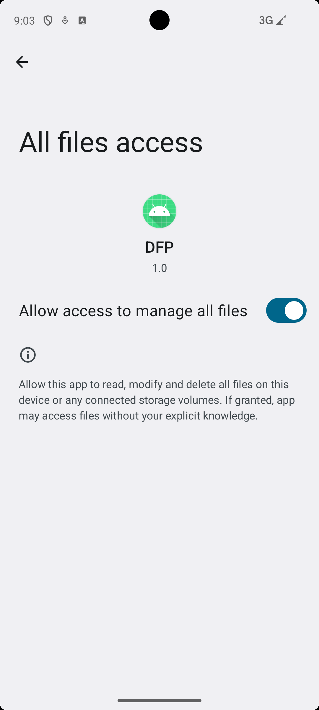
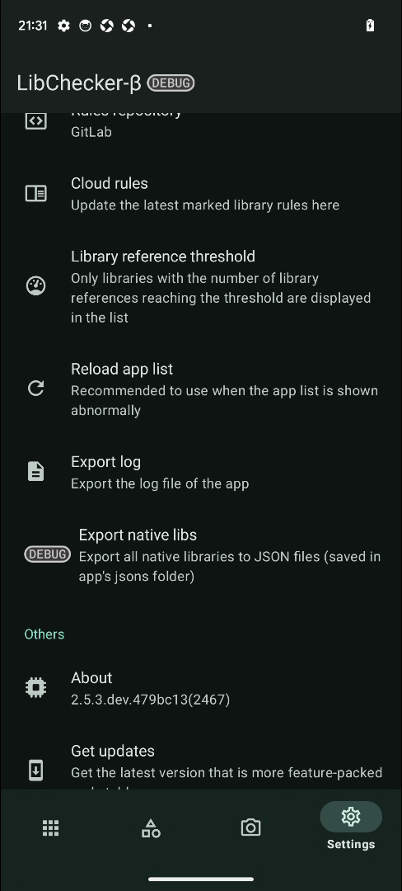

## Notice

All the releases are specific for Android 14.

## DeviceFP

DeviceFP is our tools for collecting the signals SDK use.When you run the deviceFP for first time ,you will not get the signals .Because you need you grant all the permissions it requests. 



Then you also need to grant the file manage permission to allow it to generate the json .Click the UPDATE to grant the permission.



Then you can update it again,you will see all the information .

After that you can use the command to pull the deviceinfo.json

```
adb pull /sdcard/Android/data/com.ashenone.dfp/files/DeviceInfo.json
```

## LibChecker

Libchecker is the tools that we use to get the library information for all apps installed on the device.

### How to use the modified libchcker?




Grant all the permission ,then click Export native libs.

To compare the same batch of apps from different app stores, follow these steps:

####  1. Install apps from only one app store at a time

Each time, install all target apps from the same app store only.

For example, first install all target apps from App Store A.  
Do not mix apps from different app stores during the same round of testing.


###  2. Generate JSON files with the modified LibChecker

Open the modified version of LibChecker and generate JSON files for the installed apps.

### 3. Pull the JSON files from the device


Use the following command to pull the generated JSON files to your computer:

```
adb pull "/sdcard/Android/data/com.absinthe.libchecker.debug/files/jsons"
```

### 4. Save the JSON files into separate directories

Place the JSON files exported from App Store A into `directory_1`.

Place the JSON files exported from App Store B into `directory_2`.

For example:

```
directory_1/
  app_a.json
  app_b.json
  app_c.json

directory_2/
  app_a.json
  app_b.json
  app_c.json
```

### 5. Configure `compare.py`

In `compare.py`, set the paths to the two JSON directories:

```
dir1 = "path/to/directory_1"
dir2 = "path/to/directory_2"
```

### 6. Install the `deepdiff` dependency

Install the required Python package:

```
python3 -m pip install deepdiff
```

### 7. Run the comparison script

Run:

```
python3 compare.py
```

The script will then compare the JSON files generated from the same batch of apps across different app stores.


## FakeInfo 

FakeInfo is a tool used in our paper to generate user usage. Note that this tool is designed for the Chinese ecosystem, so the SMS content included in it is in Chinese. Modify it to your desired language as needed.


### How to use it ?

Just click it !


